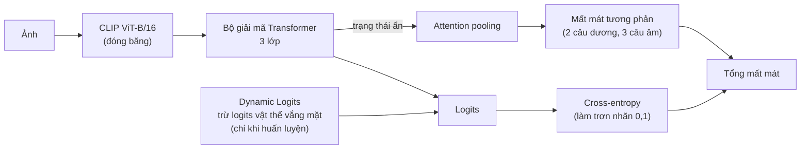
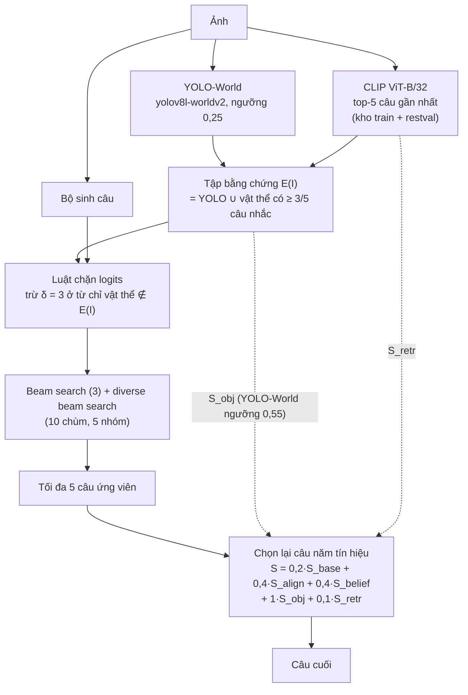

# MEHC-Cap: Kiểm soát ảo giác đối tượng hai giai đoạn dựa trên bằng chứng đa nguồn cho chú thích ảnh bằng Transformer

Tiếng Việt | [English](README_EN.md)

**Tác giả:** Phạm Nguyễn Thanh Huy, Đặng Anh Thịnh, Đỗ Võ Kim Nhi, Trần Thị Vân Anh, Đinh Thị Mận, Nguyễn Văn Thịnh\*

\* Tác giả liên hệ (corresponding author)

Mã nguồn của **MEHC-Cap** (Multi-Source Evidence-Guided Hallucination-Controlled Captioning), mô hình chú thích ảnh giảm
**ảo giác đối tượng** (câu mô tả nhắc đến vật thể không có trong ảnh) mà vẫn giữ chất lượng câu, trên một mô hình nhỏ
(CLIP ViT-B/16 + bộ giải mã Transformer). Gồm notebook huấn luyện, script đánh giá và ứng dụng demo.

## 1. Bài toán và ý tưởng

Mô hình chú thích ảnh thường nhắc đến vật thể quen thuộc dù không có trong ảnh (ví dụ thấy bàn bếp thì viết có "dining table").
Ảo giác được đo bằng **CHAIR** (CHAIRs: % câu có ảo giác, CHAIRi: % lần nhắc vật thể sai, trên 80 lớp COCO) và giữ chất lượng câu
bằng BLEU, METEOR, ROUGE-L, CIDEr, SPICE.

Ý tưởng: kiểm soát ảo giác ở **ba giai đoạn** mà không huấn luyện lại bộ phát hiện.

1. **Khi huấn luyện:** Dynamic Logits (trừ logits của vật thể vắng mặt trong ảnh, chỉ khi huấn luyện) và học tương phản đa mẫu dương với attention pooling.
2. **Khi giải mã:** luật chặn logits cố định `z' = z - δ · 1[từ chỉ vật thể ∉ E(I)]`, với `E(I)` là tập vật thể có bằng chứng: YOLO-World phát hiện **hoặc** được ít nhất `r = 3` trong `K = 5` câu truy hồi nhắc tới.
3. **Khi chọn câu:** chọn lại trong tối đa 5 câu ứng viên bằng năm tín hiệu.

## 2. Pipeline

**Huấn luyện** (`notebooks/02`, chạy trên Kaggle)



**Suy luận** (`eval/` và `notebooks/eval/`)



Năm tín hiệu chọn lại câu (mỗi tín hiệu chuẩn hóa min-max trong tập ứng viên của một ảnh):

| Tín hiệu | Ý nghĩa |
|---|---|
| `S_base` | độ tự tin của bộ sinh câu (log-xác suất trung bình của token) |
| `S_align` | độ tương thích ảnh - câu (cosine CLIP ViT-B/16, kiểu CLIPScore) |
| `S_belief` | xác suất câu sau khi cập nhật theo kết quả phát hiện đối tượng (belief revision) |
| `S_obj` | trừ số lớp vật thể trong câu nằm ngoài `E(I)` |
| `S_retr` | độ gần câu ứng viên với các câu truy hồi |

Ngưỡng tin cậy của YOLO-World: luật chặn và `S_belief` dùng 0,25, riêng tập bằng chứng của `S_obj` dùng 0,55 (chọn trên 1.000 ảnh val). Lớp chặn học được (notebook 03) chỉ là thí nghiệm đối chứng ban đầu, không có trong kết quả cuối.

## 3. Kết quả (tập kiểm tra Karpathy, một seed)

Tên cấu hình ghép từ các thành phần được bật:

| Mã | Nghĩa |
|---|---|
| `CE` | Mô hình cơ sở, chỉ huấn luyện bằng cross-entropy |
| `DL` / `CL` | Bộ sinh câu chỉ có Dynamic Logits / chỉ có học tương phản |
| `DL+CL` | Bộ sinh câu đề xuất, có cả hai |
| `LB(·)` | Luật chặn logits, trong ngoặc là nguồn bằng chứng: `Y` = YOLO-World, `R` = câu truy hồi, `Y+R` = hợp hai nguồn |
| `RR` | Bộ chọn lại câu năm tín hiệu |

MEHC-Cap là cấu hình đầy đủ **`DL+CL + LB(Y+R) + RR`**. MS COCO: 5.000 ảnh kiểm tra, CHAIR tính trên 4.967 ảnh có nhãn vật thể. CHs/CHi: CHAIRs/CHAIRi (%, càng thấp càng tốt).

| Tập | Cấu hình | B-4 | METEOR | ROUGE-L | CIDEr | SPICE | CHs | CHi |
|---|---|---|---|---|---|---|---|---|
| MS COCO | `CE` | 36,71 | 28,70 | 57,50 | 119,90 | 21,69 | 7,01 | 4,88 |
| MS COCO | `CE + RR` | 35,58 | 28,35 | 56,31 | 119,26 | 21,66 | 2,56 | 1,85 |
| MS COCO | `DL+CL + LB(Y+R)` | 36,88 | 28,55 | 57,61 | 119,67 | 21,59 | 3,46 | 2,49 |
| MS COCO | **`DL+CL + LB(Y+R) + RR`** | 35,98 | 28,36 | 56,61 | 119,72 | 21,73 | **1,71** | **1,24** |
| Flickr30k | `CE` | 32,81 | 24,15 | 52,46 | 73,93 | 17,86 | 6,48 | 4,94 |
| Flickr30k | `CE + RR` | 31,71 | 24,22 | 51,97 | 74,20 | 18,00 | 3,95 | 3,24 |
| Flickr30k | `DL+CL + LB(Y+R)` | 30,21 | 23,85 | 51,97 | 68,06 | 17,73 | 3,24 | 2,62 |
| Flickr30k | **`DL+CL + LB(Y+R) + RR`** | 31,02 | 23,88 | 52,02 | 71,61 | 18,11 | **2,23** | **1,96** |

- Trên MS COCO, mô hình đề xuất giảm CHAIRs từ 7,01 xuống 1,71 (-75,6%) và CHAIRi từ 4,88 xuống 1,24 (-74,6%), CIDEr thấp hơn cơ sở 0,18 điểm, SPICE gần như không đổi (21,73 so với 21,69).
- Trên Flickr30k, CHAIRs giảm từ 6,48 xuống 2,23 nhưng CIDEr thấp hơn cơ sở 2,32 điểm: ở đó giảm ảo giác đổi lấy một phần chất lượng câu.
- Mô hình không giảm CHAIR bằng cách né nhắc vật thể: số lớp vật thể COCO mỗi câu là 1,33 (đề xuất) so với 1,46 (cơ sở) và 1,36 (câu tham chiếu), tỉ lệ câu không nhắc vật thể nào là 8,36% so với 5,96% (câu tham chiếu 10,88%), recall theo vật thể trong câu tham chiếu 68,96% so với 71,05%.
- So từng ảnh với `CE`: 293 ảnh hết ảo giác, 30 ảnh phát sinh ảo giác mới (phần lớn do YOLO-World nhận nhầm), 55 ảnh cả hai đều sai.

**Đóng góp của từng tín hiệu chọn lại câu** (MS COCO test, bộ sinh `DL+CL + LB(Y+R)`):

| Cấu hình | B-4 | CIDEr | CHs | CHi |
|---|---|---|---|---|
| Trước khi chọn lại câu | 36,88 | 119,67 | 3,46 | 2,49 |
| Năm tín hiệu (r = 3) | 35,98 | 119,72 | 1,71 | 1,24 |
| Bỏ `S_obj` | 36,31 | 120,87 | 2,60 | 1,86 |
| Bỏ `S_retr` | 35,78 | 118,66 | 1,71 | 1,25 |
| Năm tín hiệu, r = 1 | 36,08 | 120,23 | 1,97 | 1,42 |

`S_obj` giảm ảo giác (bỏ đi thì CHAIRs tăng lên 2,60), còn `S_retr` giữ chất lượng câu (bỏ đi thì CIDEr giảm 1,06 điểm, CHAIRs không đổi).

**Chi phí suy luận (mỗi ảnh, RTX 3050 Laptop):** toàn quy trình 1.855 ms, mô hình cơ sở một câu beam search 357 ms. Truy hồi thêm 52 ms, hai tín hiệu dựa trên câu truy hồi thêm 38 ms, YOLO-World 111 ms, bộ chọn lại câu 197 ms.

**Bật/tắt từng thành phần (MS COCO, 5.000 ảnh, một seed).** "Trước"/"sau" là trước/sau khi thêm `RR`. CHAIRs, CHAIRi (%) tính trên 4.967 ảnh, recall là % vật thể trong câu tham chiếu được câu sinh nhắc tới. Nguồn bằng chứng dùng cho cả luật chặn và tín hiệu `S_obj`, các hàng không chặn dùng hợp hai nguồn. δ = 3 chọn trên tập kiểm định với nguồn hợp, giữ nguyên cho các nguồn còn lại. Không đo SPICE.

| # | Cấu hình | CHAIRs trước | CIDEr trước | CHAIRs sau | CHAIRi sau | CIDEr sau | Recall sau |
|---|---|---|---|---|---|---|---|
| C1 | `CE` | 7,01 | 119,90 | 2,56 | 1,85 | 119,26 | 69,4 |
| C2 | `CE + LB(Y+R)` | 3,81 | 119,14 | 2,03 | 1,49 | 119,08 | 68,9 |
| C3 | `DL` | 7,05 | 119,18 | 3,10 | 2,20 | 119,07 | 70,0 |
| C4 | `DL + LB(Y+R)` | 3,24 | 118,79 | 2,11 | 1,51 | 119,44 | 69,5 |
| C5 | `CL` | 7,15 | 120,43 | 2,88 | 2,03 | 119,56 | 69,9 |
| C6 | `CL + LB(Y+R)` | 3,28 | 120,08 | 1,89 | 1,36 | 120,22 | 69,4 |
| C7 | `DL+CL` | 6,68 | 120,79 | 2,56 | 1,83 | 120,37 | 69,4 |
| C8 | `DL+CL + LB(Y)` | 2,90 | 118,51 | 1,27 | 0,95 | 117,01 | 66,7 |
| C9 | `DL+CL + LB(R)` | 2,64 | 114,83 | 1,25 | 1,07 | 112,61 | 59,6 |
| **C10** | **`DL+CL + LB(Y+R)`** | **3,46** | **119,67** | **1,71** | **1,24** | **119,72** | **69,0** |

Nhận xét:
- Luật chặn là thành phần giảm CHAIRs nhiều nhất ở bước sinh câu: 6,68 (C7) xuống 3,46 (C10) với bộ sinh đề xuất, 7,01 (C1) xuống 3,81 (C2) với bộ sinh cơ sở.
- Khi không chặn, bộ sinh đề xuất giảm ảo giác ít (CHAIRs trước 6,68 so với 7,01, sau `RR` bằng nhau ở 2,56) nhưng CIDEr cao hơn (120,37 so với 119,26). Khi cùng bật luật chặn, C10 có CHAIRs 1,71 so với 2,03 của C2 và CIDEr 119,72 so với 119,08.
- Từng thành phần huấn luyện đứng riêng chưa đủ: với luật chặn, chỉ Dynamic Logits (C4) cho CHAIRs 2,11 và chỉ học tương phản (C6) cho 1,89, đều cao hơn khi kết hợp (C10, 1,71).
- Chỉ dùng YOLO-World (C8) hoặc chỉ câu truy hồi (C9) cho CHAIRs thấp hơn nhưng CIDEr giảm 2,71 và 7,11 điểm, recall chỉ 66,7% và 59,6%, tức mô hình nhắc ít vật thể hơn hẳn. Nguồn hợp cân bằng giữa ảo giác và chất lượng câu nên được chọn.

Giới hạn: mỗi cấu hình chỉ có một lần chạy (một seed); mô hình đề xuất huấn luyện 48 epoch còn mô hình cơ sở 40 epoch; CHAIR chỉ đo 80 lớp COCO, không đo thuộc tính, số lượng, quan hệ; Flickr30k không có nhãn vật thể COCO nên CHAIR ở đó dựa trên nhãn rút từ câu tham chiếu.

## 4. Cấu trúc thư mục

| Đường dẫn | Vai trò |
|---|---|
| `notebooks/01_baseline_clipvit-transformer-coco2014.ipynb` | Huấn luyện mô hình cơ sở (cross-entropy), ra `restval_baseline_best_model.pth` |
| `notebooks/02_train_proposed_dynlogits_contrastive_attnpool.ipynb` | Huấn luyện **mô hình đề xuất** (Dynamic Logits + học tương phản đa mẫu dương + attention pooling), hai giai đoạn (xem ô đầu notebook), dùng checkpoint epoch 48 (`dynlogits_contrastive_attnpool_epoch48_model.pth`, loss kiểm định thấp nhất) |
| `notebooks/03_ablation_learned_gate_evgatedrop.ipynb` | Phương án đối chứng: lớp chặn học được (EvidenceGate) |
| `notebooks/04_flickr30k_train_baseline.ipynb`, `05_flickr30k_train_proposed.ipynb` | Huấn luyện cơ sở và đề xuất trên Flickr30k |
| `notebooks/eval/coco2014-eval-preranking.ipynb` | Đánh giá câu trước khi chọn lại (beam search thường) |
| `notebooks/eval/coco2014-eval-reranking.ipynb` | Đánh giá toàn quy trình: sinh ứng viên có luật chặn, chọn lại câu |
| `eval/build_yoloworld_report.py` | Dựng báo cáo vật thể YOLO-World (bằng chứng) cho tập cần đánh giá |
| `eval/retrieval_logit_bias_experiment.py` | Sinh câu có luật chặn (`--configs 0,δ`), tùy chọn nguồn bằng chứng `--evidence union/yolo/retr` |
| `eval/logit_bias_final_eval.py` | Ghép các mảnh và chấm đủ chỉ số |
| `eval/sobj_threshold_eval.py`, `sobj_threshold_val.py` | Chấm bộ chọn lại câu năm tín hiệu (ngưỡng r, nguồn bằng chứng, SPICE, độ phủ đối tượng) trên test và val |
| `eval/sretr_experiment.py`, `signal_table.py`, `rerank_with_new_objects.py` | Tín hiệu `S_obj`, `S_retr`; bảng ba/năm tín hiệu; chọn lại câu cho cấu hình không chặn |
| `eval/flickr30k_eval.py` | Đánh giá Flickr30k (chặn logits + chọn lại câu) |
| `eval/run_onoff_ablation.sh`, `onoff_postprocess.py` | Thí nghiệm bật/tắt thành phần (xem mục 6) |
| `webapp/` | Ứng dụng demo FastAPI + Next.js chạy từng bước của pipeline; xem `webapp/backend/README.md` |
| `papers/` | Tài liệu tham khảo |

Module dùng chung ở gốc `demo/`: `local_captioner.py`, `generate.py`, `clipscore.py`, `llm.py`, `formula_reranker.py`, `chair_metric.py`, `chair_synonyms.txt`, `evaluate_baseline.py`, `evaluate_reranked_quality.py`.

## 5. Cài đặt và dữ liệu

- Python 3.10, `pip install -r requirements.txt` (ở gốc `demo/`), PyTorch có CUDA, Java (cho METEOR và SPICE).
- Dữ liệu đặt ở `../dataset/` (ngoài repo): `dataset_coco.json` (Karpathy split), `instances_val2014.json`, `val2014/val2014/` (ảnh), `retrieval_cache/` (kho câu và chỉ số láng giềng), từ điển `coco2014_karpathy_restval_dynlogits_contrastive_attnpool_vocab.json` (10.031 từ).
- Checkpoint (`*.pth`, khoảng 500 MB mỗi file) đặt ở gốc `demo/`; bản dùng cho demo nằm trong `webapp/backend/weights/`. Huấn luyện chạy trên Kaggle (T4), đánh giá chạy cục bộ.
- Hằng số của notebook 01, 02, 04, 05 đã đặt theo cấu hình báo cáo (decoder 3 lớp, batch 64 cho COCO). Các bản gốc ở `research/notebooks/` ghi giá trị khác (96 / 2 lớp); chưa chạy lại trên Kaggle để kiểm chứng.

## 6. Chạy lại đánh giá (từ thư mục `demo/`)

1. **Bằng chứng YOLO-World** cho tập đánh giá:

   ```
   python Graduation_Thesis/eval/build_yoloworld_report.py --report results/seed43_restval_e10_rerank_test.json --output results/seed43_restval_e10_rerank_test_yoloworld.json
   ```

2. **Chọn δ trên 1.000 ảnh val** (lần quét này chạy một lần trước khi chuyển sang E48 và chưa chạy lại; chọn δ cho CHAIRs thấp nhất sau chọn lại câu, với CIDEr không thấp hơn trường hợp không chặn quá 1 điểm):

   ```
   python Graduation_Thesis/eval/retrieval_logit_bias_experiment.py --report results/val1000_yoloworld.json --max-images 1000 --checkpoint restval_dynlogits_contrastive_attnpool_epoch40_model.pth --vocab-file ../dataset/coco2014_karpathy_restval_dynlogits_contrastive_attnpool_vocab.json --configs 0,0 0,1 0,2 0,3 0,4 --output results/ksweep_e40_val1000.json
   ```

3. **Sinh câu trên test** với δ = 3, chia 4 mảnh để dừng giữa chừng không mất kết quả (`--save-rows` giữ ứng viên cho bước 4):

   ```
   python Graduation_Thesis/eval/retrieval_logit_bias_experiment.py --report results/seed43_restval_e10_rerank_test_yoloworld.json --start 0 --max-images 1250 --maj 3 --save-rows --checkpoint dynlogits_contrastive_attnpool_epoch48_model.pth --vocab-file ../dataset/coco2014_karpathy_restval_dynlogits_contrastive_attnpool_vocab.json --configs 0,3 --output results/e48_g3_test_part0.json
   ```

   Lặp với `--start 1250`, `2500`, `3750`.

4. **Chấm bộ chọn lại câu năm tín hiệu** (có SPICE và độ phủ đối tượng). `--report` là báo cáo 5.000 ảnh đã ghép các mảnh (xem `eval/onoff_postprocess.py`, hàm ghép):

   ```
   python Graduation_Thesis/eval/sobj_threshold_eval.py --report results/e40_g3_yoloworld_merged.json --output results/e40_g3_sobj_threshold_test.json --thresholds 3 --spice
   ```

   Khóa `five_score_3of5` trong file kết quả là cấu hình cuối; `before_rerank` là câu đầu của beam search.

   Ngưỡng 0,55 cho `S_obj` chỉ đổi bước chọn lại câu nên được áp bằng cách chấm lại các câu ứng viên đã sinh, không sinh lại: `research/scripts/rerank_only_test55.py` (mô hình đề xuất) và `research/scripts/rerank_c55_rest.py <tên cấu hình>` (các cấu hình bật/tắt) ở gốc `demo/`, kết quả trong `results/confsweep/rr55/`.

5. **Thí nghiệm bật/tắt** (hai luồng GPU song song, mỗi luồng chạy lần lượt các đoạn 1.250 ảnh, bỏ qua đoạn đã có):

   ```
   bash Graduation_Thesis/eval/run_onoff_ablation.sh A
   bash Graduation_Thesis/eval/run_onoff_ablation.sh B
   python Graduation_Thesis/eval/onoff_postprocess.py --name cs_g3 --evidence union --spice
   ```

   Tên cấu hình và ý nghĩa nằm ở đầu `run_onoff_ablation.sh`. Giữ tối đa 2 tiến trình GPU cùng lúc.

Cấu hình cuối của MEHC-Cap: YOLO-World ngưỡng 0,25 (tối đa 20 vật thể) cho luật chặn và `S_belief`, 0,55 cho tập bằng chứng của `S_obj`, `K = 5`, `r = 3`, `δ = 3`, `J = 5` ứng viên, trọng số `w_base/w_align/w_belief/w_obj/w_retr = 0,2/0,4/0,4/1/0,1`, `ε = 10⁻⁶`.
