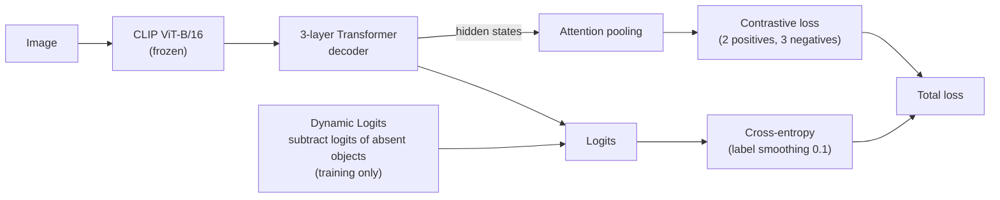
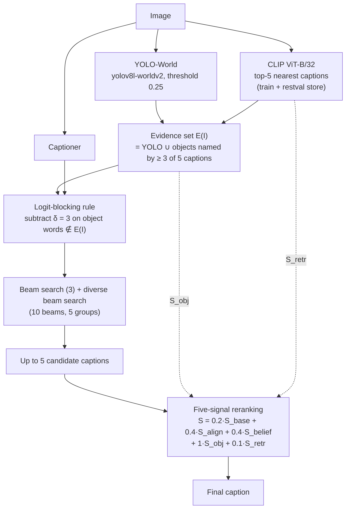

# Image Captioning Research: Reducing Object Hallucination on MS COCO 2014 and Flickr30k

[Tiếng Việt](README.md) | English

A research repository on image captioning. The current direction is reducing **object hallucination** (captions that mention objects
that are not in the image) while keeping caption quality, on a small model (CLIP ViT-B/16 + Transformer decoder). The code is also the
experimental part of the graduation thesis. It contains the training notebooks, the evaluation scripts and a demo web app.

## 1. Problem and idea

Captioning models often mention familiar objects that are not visible (for example writing "dining table" for a kitchen counter).
Hallucination is measured with **CHAIR** (CHAIRs: % of captions with a hallucinated object, CHAIRi: % of mentioned objects that are
hallucinated, over the 80 COCO classes). Caption quality is tracked with BLEU, METEOR, ROUGE-L, CIDEr and SPICE.

The idea is to control hallucination at **three stages**, without retraining the object detector.

1. **Training:** Dynamic Logits (subtract the logits of objects that are absent from the image, training only) and multi-positive contrastive learning with attention pooling.
2. **Decoding:** a fixed logit-blocking rule `z' = z - δ · 1[object word ∉ E(I)]`, where `E(I)` is the set of objects with evidence: detected by YOLO-World **or** named by at least `r = 3` of the `K = 5` retrieved captions.
3. **Selection:** rerank up to 5 candidate captions with five signals.

## 2. Pipeline

**Training** (`notebooks/02`, run on Kaggle)



**Inference** (`eval/` and `notebooks/eval/`)



The five reranking signals (each min-max normalised within one image's candidates):

| Signal | Meaning |
|---|---|
| `S_base` | captioner confidence (mean token log-probability) |
| `S_align` | image-text compatibility (CLIP ViT-B/16 cosine, CLIPScore style) |
| `S_belief` | caption probability after belief revision with the detection results |
| `S_obj` | minus the number of object classes in the caption that lie outside `E(I)` |
| `S_retr` | closeness of the candidate to the retrieved captions |

Control configuration: a **learned blocking layer** (a table of blocking strengths `δ(n, y)` learned in training, multiplied by μ = 6 at inference).
The final proposed model uses the **fixed** blocking rule.

## 3. Results (Karpathy test sets, single seed)

MS COCO: 5,000 test images, CHAIR computed on the 4,967 images that have object labels. "Before" is the first beam-search caption,
"5 signals" is after reranking. CHs/CHi: CHAIRs/CHAIRi (%, lower is better).

| Dataset | Configuration | B-4 | METEOR | ROUGE-L | CIDEr | SPICE | CHs | CHi |
|---|---|---|---|---|---|---|---|---|
| MS COCO | Baseline, before | 36.71 | 28.70 | 57.50 | 119.90 | 21.69 | 7.01 | 4.88 |
| MS COCO | Baseline + reranking | 35.82 | 28.51 | 56.52 | 119.87 | 21.77 | 3.10 | 2.20 |
| MS COCO | Proposed, before | 36.88 | 28.55 | 57.61 | 119.67 | 21.59 | 3.46 | 2.49 |
| MS COCO | **Proposed, 5 signals** | 36.27 | 28.50 | 56.87 | **120.49** | 21.84 | **2.44** | **1.76** |
| Flickr30k | Baseline, before | 32.81 | 24.15 | 52.46 | 73.93 | 17.86 | 6.48 | 4.94 |
| Flickr30k | Baseline + reranking | 31.59 | 24.27 | 51.99 | 74.33 | 18.03 | 4.26 | 3.52 |
| Flickr30k | Proposed, before | 30.21 | 23.85 | 51.97 | 68.06 | 17.73 | 3.24 | 2.62 |
| Flickr30k | **Proposed, 5 signals** | 31.09 | 23.85 | 52.01 | 71.84 | 18.11 | 2.74 | 2.33 |

- On MS COCO the proposed model lowers CHAIRs from 7.01 to 2.44 (-65.2%) and CHAIRi from 4.88 to 1.76, with CIDEr 0.59 points higher.
- On Flickr30k CHAIR also drops, but CIDEr is 2.09 points below the baseline: there, less hallucination costs some caption quality.
- Captions do not get shorter and do not mention noticeably fewer objects: 1.37 COCO objects per caption (proposed) versus 1.46 (baseline), and recall against objects named by the reference captions is 70.0% versus 71.1%.

**Fixed blocking rule vs learned blocking layer** (MS COCO test):

| Configuration | Position | CIDEr | CHs | CHi |
|---|---|---|---|---|
| Baseline, no blocking | before / 5 signals | 119.90 / 119.87 | 7.01 / 3.10 | 4.88 / 2.20 |
| Learned blocking layer, μ = 6 | before / 5 signals | 118.27 / 119.54 | 4.37 / 3.04 | 3.08 / 2.20 |
| Fixed blocking rule, δ = 3 | before / 5 signals | 119.67 / 120.49 | 3.46 / 2.44 | 2.49 / 1.76 |

The two configurations also differ in how they are trained, so the gap cannot be attributed to the blocking mechanism alone.

**Contribution of each reranking signal** (MS COCO test, proposed model):

| Configuration | CIDEr | CHs | CHi |
|---|---|---|---|
| Before reranking | 119.67 | 3.46 | 2.49 |
| Five signals (r = 3) | 120.49 | 2.44 | 1.76 |
| Without `S_obj` | 120.87 | 2.60 | 1.86 |
| Without `S_retr` | 119.34 | 2.46 | 1.78 |
| Five signals, r = 1 | 120.68 | 2.48 | 1.78 |

**Inference cost (per image, RTX 3050 Laptop):** 1,855 ms for the full pipeline versus 357 ms for the baseline with one beam-search caption. Retrieval adds 52 ms, the two retrieval-based signals 38 ms, YOLO-World 111 ms, the reranker 197 ms.

**On/off ablation (MS COCO, 5,000 images, one seed).** "Before"/"after" means before/after the five-signal reranker. CHAIRs and CHAIRi (%) are computed on 4,967 images. The evidence source feeds both the blocking rule and the `S_obj` signal, and the two no-blocking rows use the union of both sources. δ = 3 was chosen on the validation split with the union source and kept for the other sources. SPICE was not measured.

| Configuration | CHAIRs before | CIDEr before | CHAIRs after | CHAIRi after | CIDEr after | Recall after |
|---|---|---|---|---|---|---|
| Baseline generator, no blocking | 7.01 | 119.90 | 3.10 | 2.20 | 119.87 | 70.3 |
| Baseline generator, blocking (YOLO-World + retrieval) | 3.81 | 119.14 | 2.76 | 1.99 | 119.78 | 69.9 |
| Proposed generator, no blocking | 6.68 | 120.79 | 3.06 | 2.17 | 121.26 | 70.4 |
| Proposed generator, blocking (YOLO-World only) | 2.90 | 118.51 | 2.21 | 1.66 | 118.66 | 68.5 |
| Proposed generator, blocking (retrieval only) | 2.64 | 114.83 | 1.25 | 1.07 | 112.61 | 59.6 |
| **Proposed generator, blocking (YOLO-World + retrieval)** | **3.46** | **119.67** | **2.44** | **1.76** | **120.49** | **70.0** |

Observations:
- Logit blocking removes the most hallucination at generation time (CHAIRs 6.68 to 3.46 for the proposed generator, 7.01 to 3.81 for the baseline).
- Dynamic Logits and contrastive training reduce hallucination only slightly (without blocking, CHAIRs 6.68 vs 7.01 before and 3.06 vs 3.10 after reranking) but give higher CIDEr and recall. With blocking on for both, CHAIRs after reranking is 2.44 vs 2.76.
- Retrieval-only evidence gives the lowest CHAIRs but CIDEr drops by 7.88 points and recall falls to 59.6%, i.e. the model simply mentions far fewer objects. The union source gives the best CIDEr and recall, so it is the one used.

Limitations: each configuration was run once (one seed); the proposed model was trained for 48 epochs and the baseline for 40; CHAIR only covers the 80 COCO classes, not attributes, counts or relations;
Flickr30k has no COCO object labels, so CHAIR there relies on labels extracted from the reference captions.

## 4. Folder layout

| Path | Role |
|---|---|
| `notebooks/01_baseline_clipvit-transformer-coco2014.ipynb` | Train the baseline (cross-entropy), produces `restval_baseline_best_model.pth` |
| `notebooks/02_train_proposed_dynlogits_contrastive_attnpool.ipynb` | Train the **proposed model** (Dynamic Logits + multi-positive contrastive learning + attention pooling) in two stages (see the first cell), uses the epoch-48 checkpoint (`dynlogits_contrastive_attnpool_epoch48_model.pth`, lowest validation loss) |
| `notebooks/03_ablation_learned_gate_evgatedrop.ipynb` | Control configuration: learned blocking layer (EvidenceGate) |
| `notebooks/04_flickr30k_train_baseline.ipynb`, `05_flickr30k_train_proposed.ipynb` | Train baseline and proposed model on Flickr30k |
| `notebooks/eval/coco2014-eval-preranking.ipynb` | Evaluate captions before reranking (plain beam search) |
| `notebooks/eval/coco2014-eval-reranking.ipynb` | Evaluate the full pipeline: candidate generation with the blocking rule, then reranking |
| `eval/build_yoloworld_report.py` | Build the YOLO-World object report (the evidence) for an evaluation split |
| `eval/retrieval_logit_bias_experiment.py` | Generate captions with the blocking rule (`--configs 0,δ`), optional evidence source `--evidence union/yolo/retr` |
| `eval/logit_bias_final_eval.py` | Merge shards and compute all metrics |
| `eval/sobj_threshold_eval.py`, `sobj_threshold_val.py` | Score the five-signal reranker (threshold r, evidence source, SPICE, object coverage) on test and val |
| `eval/sretr_experiment.py`, `signal_table.py`, `rerank_with_new_objects.py` | `S_obj`/`S_retr` signals; three/five-signal table; reranking for the no-blocking configuration |
| `eval/flickr30k_eval.py` | Flickr30k evaluation (logit blocking + reranking) |
| `eval/run_onoff_ablation.sh`, `onoff_postprocess.py` | On/off component experiments (see section 6) |
| `webapp/` | Demo app (FastAPI + Next.js) that runs the pipeline step by step; see `webapp/backend/README.md` |
| `papers/` | Reference papers |

Shared modules in the `demo/` root: `local_captioner.py`, `generate.py`, `clipscore.py`, `llm.py`, `formula_reranker.py`, `chair_metric.py`, `chair_synonyms.txt`, `evaluate_baseline.py`, `evaluate_reranked_quality.py`.

## 5. Setup and data

- Python 3.10, `pip install -r requirements.txt` (in the `demo/` root), PyTorch with CUDA, Java (for METEOR and SPICE).
- Data lives in `../dataset/` (outside the repo): `dataset_coco.json` (Karpathy split), `instances_val2014.json`, `val2014/val2014/` (images), `retrieval_cache/` (caption store and neighbour indices), vocabulary `coco2014_karpathy_restval_dynlogits_contrastive_attnpool_vocab.json` (10,031 words).
- Checkpoints (`*.pth`, about 500 MB each) go in the `demo/` root; the copies used by the demo are in `webapp/backend/weights/`. Training ran on Kaggle (T4), evaluation ran locally.
- The constants in notebooks 01, 02, 04 and 05 are set to the thesis values (Table 3.2: 3-layer decoder, batch 64 for COCO). The originals in `research/notebooks/` carry different values (96 / 2 layers); the notebooks have not been re-run on Kaggle to confirm.

## 6. Re-running the evaluation (from `demo/`)

1. **YOLO-World evidence** for the evaluation split:

   ```
   python Graduation_Thesis/eval/build_yoloworld_report.py --report results/seed43_restval_e10_rerank_test.json --output results/seed43_restval_e10_rerank_test_yoloworld.json
   ```

2. **Choose δ on the first 1,000 val images** (this sweep was run once before switching to E48 and has not been repeated; pick the δ with the lowest CHAIRs after reranking whose CIDEr is not more than 1 point below the no-blocking case):

   ```
   python Graduation_Thesis/eval/retrieval_logit_bias_experiment.py --report results/val1000_yoloworld.json --max-images 1000 --checkpoint restval_dynlogits_contrastive_attnpool_epoch40_model.pth --vocab-file ../dataset/coco2014_karpathy_restval_dynlogits_contrastive_attnpool_vocab.json --configs 0,0 0,1 0,2 0,3 0,4 --output results/ksweep_e40_val1000.json
   ```

3. **Generate on test** with δ = 3, in 4 shards so an interrupted run loses nothing (`--save-rows` keeps the candidates for step 4):

   ```
   python Graduation_Thesis/eval/retrieval_logit_bias_experiment.py --report results/seed43_restval_e10_rerank_test_yoloworld.json --start 0 --max-images 1250 --maj 3 --save-rows --checkpoint dynlogits_contrastive_attnpool_epoch48_model.pth --vocab-file ../dataset/coco2014_karpathy_restval_dynlogits_contrastive_attnpool_vocab.json --configs 0,3 --output results/e48_g3_test_part0.json
   ```

   Repeat with `--start 1250`, `2500`, `3750`.

4. **Score the five-signal reranker** (with SPICE and object coverage). `--report` is the 5,000-image report with the shards merged (see the merge step in `eval/onoff_postprocess.py`):

   ```
   python Graduation_Thesis/eval/sobj_threshold_eval.py --report results/e40_g3_yoloworld_merged.json --output results/e40_g3_sobj_threshold_test.json --thresholds 3 --spice
   ```

   The key `five_score_3of5` in the output is the final configuration; `before_rerank` is the first beam-search caption.

5. **On/off experiments** (two parallel GPU workers, each running its 1,250-image shards in turn and skipping finished ones):

   ```
   bash Graduation_Thesis/eval/run_onoff_ablation.sh A
   bash Graduation_Thesis/eval/run_onoff_ablation.sh B
   python Graduation_Thesis/eval/onoff_postprocess.py --name cs_g3 --evidence union --spice
   ```

   Configuration names and meaning are listed at the top of `run_onoff_ablation.sh`. Keep at most 2 GPU processes at a time.

Settings used in the thesis: YOLO-World threshold 0.25 (at most 20 objects), `K = 5`, `r = 3`, `δ = 3`, `J = 5` candidates, weights `w_base/w_align/w_belief/w_obj/w_retr = 0.2/0.4/0.4/1/0.1`, `ε = 10⁻⁶`.
