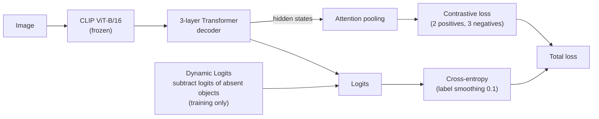
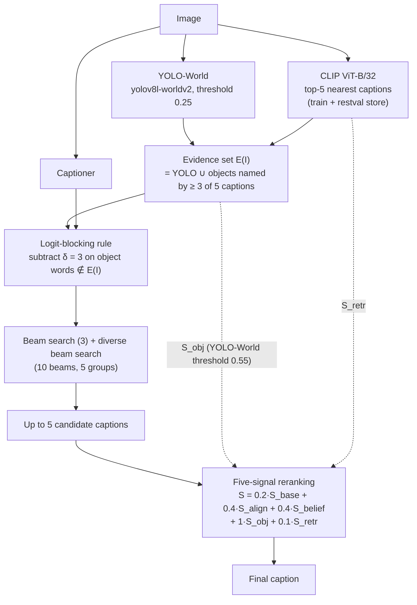

# MEHC-Cap: Multi-Source Evidence-Guided Two-Stage Object Hallucination Control for Transformer-Based Image Captioning

[Tiếng Việt](README.md) | English

**Authors:** Phạm Nguyễn Thanh Huy, Đặng Anh Thịnh, Đỗ Võ Kim Nhi, Trần Thị Vân Anh, Đinh Thị Mận, Nguyễn Văn Thịnh\*

\* Corresponding author

Code for **MEHC-Cap** (Multi-Source Evidence-Guided Hallucination-Controlled Captioning), an image captioning model that reduces
**object hallucination** (captions that mention objects that are not in the image) while keeping caption quality, on a small model
(CLIP ViT-B/16 + Transformer decoder). It contains the training notebooks, the evaluation scripts and a demo web app.

## 1. Problem and idea

Captioning models often mention familiar objects that are not visible (for example writing "dining table" for a kitchen counter).
Hallucination is measured with **CHAIR** (CHAIRs: % of captions with a hallucinated object, CHAIRi: % of mentioned objects that are
hallucinated, over the 80 COCO classes). Caption quality is tracked with BLEU, METEOR, ROUGE-L, CIDEr and SPICE.

The idea is to control hallucination at **three stages**, without retraining the object detector.

1. **Training:** Dynamic Logits (subtract the logits of objects that are absent from the image, training only) and multi-positive contrastive learning with attention pooling.
2. **Decoding:** a fixed logit-blocking rule `z' = z - δ · 1[object word ∉ E(I)]`, where `E(I)` is the set of objects with evidence: detected by YOLO-World **or** named by at least `r = 3` of the `K = 5` retrieved captions.
3. **Selection:** rerank up to 5 candidate captions with five signals.

## 2. Pipeline

**Training** (`notebooks/02`, run on Kaggle)



**Inference** (`eval/` and `notebooks/eval/`)



The five reranking signals (each min-max normalised within one image's candidates):

| Signal | Meaning |
|---|---|
| `S_base` | captioner confidence (mean token log-probability) |
| `S_align` | image-text compatibility (CLIP ViT-B/16 cosine, CLIPScore style) |
| `S_belief` | caption probability after belief revision with the detection results |
| `S_obj` | minus the number of object classes in the caption that lie outside `E(I)` |
| `S_retr` | closeness of the candidate to the retrieved captions |

YOLO-World confidence threshold: the blocking rule and `S_belief` use 0.25, and only the evidence set of `S_obj` uses 0.55 (chosen on 1,000 validation images).
The learned blocking layer (notebook 03) was an early control experiment and is not part of the final results.

## 3. Results (Karpathy test sets, single seed)

Configuration names list the components that are switched on:

| Code | Meaning |
|---|---|
| `CE` | Baseline, trained with cross-entropy only |
| `DL` / `CL` | Generator with Dynamic Logits only / contrastive learning only |
| `DL+CL` | Proposed generator, with both |
| `LB(·)` | Logit blocking rule, with the evidence source in brackets: `Y` = YOLO-World, `R` = retrieved captions, `Y+R` = union of both |
| `RR` | Five-signal reranker |

MEHC-Cap is the full configuration **`DL+CL + LB(Y+R) + RR`**. MS COCO: 5,000 test images, CHAIR computed on the 4,967 images that have object labels. CHs/CHi: CHAIRs/CHAIRi (%, lower is better).

| Dataset | Configuration | B-4 | METEOR | ROUGE-L | CIDEr | SPICE | CHs | CHi |
|---|---|---|---|---|---|---|---|---|
| MS COCO | `CE` | 36.71 | 28.70 | 57.50 | 119.90 | 21.69 | 7.01 | 4.88 |
| MS COCO | `CE + RR` | 35.58 | 28.35 | 56.31 | 119.26 | 21.66 | 2.56 | 1.85 |
| MS COCO | `DL+CL + LB(Y+R)` | 36.88 | 28.55 | 57.61 | 119.67 | 21.59 | 3.46 | 2.49 |
| MS COCO | **`DL+CL + LB(Y+R) + RR`** | 35.98 | 28.36 | 56.61 | 119.72 | 21.73 | **1.71** | **1.24** |
| Flickr30k | `CE` | 32.81 | 24.15 | 52.46 | 73.93 | 17.86 | 6.48 | 4.94 |
| Flickr30k | `CE + RR` | 31.71 | 24.22 | 51.97 | 74.20 | 18.00 | 3.95 | 3.24 |
| Flickr30k | `DL+CL + LB(Y+R)` | 30.21 | 23.85 | 51.97 | 68.06 | 17.73 | 3.24 | 2.62 |
| Flickr30k | **`DL+CL + LB(Y+R) + RR`** | 31.02 | 23.88 | 52.02 | 71.61 | 18.11 | **2.23** | **1.96** |

- On MS COCO the proposed model lowers CHAIRs from 7.01 to 1.71 (-75.6%) and CHAIRi from 4.88 to 1.24 (-74.6%), with CIDEr 0.18 points below the baseline and SPICE almost unchanged (21.73 vs 21.69).
- On Flickr30k CHAIRs drops from 6.48 to 2.23, but CIDEr is 2.32 points below the baseline: there, less hallucination costs some caption quality.
- The model does not lower CHAIR by avoiding objects: 1.33 COCO object classes per caption (proposed) versus 1.46 (baseline) and 1.36 (reference captions), 8.36% of captions mention no COCO object versus 5.96% (references 10.88%), and recall against objects named by the reference captions is 68.96% versus 71.05%.
- Per image against `CE`: 293 images lose their hallucination, 30 gain a new one (mostly from YOLO-World false detections), 55 are wrong in both.

**Contribution of each reranking signal** (MS COCO test, generator `DL+CL + LB(Y+R)`):

| Configuration | B-4 | CIDEr | CHs | CHi |
|---|---|---|---|---|
| Before reranking | 36.88 | 119.67 | 3.46 | 2.49 |
| Five signals (r = 3) | 35.98 | 119.72 | 1.71 | 1.24 |
| Without `S_obj` | 36.31 | 120.87 | 2.60 | 1.86 |
| Without `S_retr` | 35.78 | 118.66 | 1.71 | 1.25 |
| Five signals, r = 1 | 36.08 | 120.23 | 1.97 | 1.42 |

`S_obj` reduces hallucination (removing it raises CHAIRs to 2.60), while `S_retr` keeps caption quality (removing it lowers CIDEr by 1.06 points with CHAIRs unchanged).

**Inference cost (per image, RTX 3050 Laptop):** 1,855 ms for the full pipeline versus 357 ms for the baseline with one beam-search caption. Retrieval adds 52 ms, the two retrieval-based signals 38 ms, YOLO-World 111 ms, the reranker 197 ms.

**On/off ablation (MS COCO, 5,000 images, one seed).** "Before"/"after" means before/after adding `RR`. CHAIRs and CHAIRi (%) are computed on 4,967 images, and recall is the % of objects named by the reference captions that the generated caption mentions. The evidence source feeds both the blocking rule and the `S_obj` signal, and the no-blocking rows use the union of both sources. δ = 3 was chosen on the validation split with the union source and kept for the other sources. SPICE was not measured.

| # | Configuration | CHAIRs before | CIDEr before | CHAIRs after | CHAIRi after | CIDEr after | Recall after |
|---|---|---|---|---|---|---|---|
| C1 | `CE` | 7.01 | 119.90 | 2.56 | 1.85 | 119.26 | 69.4 |
| C2 | `CE + LB(Y+R)` | 3.81 | 119.14 | 2.03 | 1.49 | 119.08 | 68.9 |
| C3 | `DL` | 7.05 | 119.18 | 3.10 | 2.20 | 119.07 | 70.0 |
| C4 | `DL + LB(Y+R)` | 3.24 | 118.79 | 2.11 | 1.51 | 119.44 | 69.5 |
| C5 | `CL` | 7.15 | 120.43 | 2.88 | 2.03 | 119.56 | 69.9 |
| C6 | `CL + LB(Y+R)` | 3.28 | 120.08 | 1.89 | 1.36 | 120.22 | 69.4 |
| C7 | `DL+CL` | 6.68 | 120.79 | 2.56 | 1.83 | 120.37 | 69.4 |
| C8 | `DL+CL + LB(Y)` | 2.90 | 118.51 | 1.27 | 0.95 | 117.01 | 66.7 |
| C9 | `DL+CL + LB(R)` | 2.64 | 114.83 | 1.25 | 1.07 | 112.61 | 59.6 |
| **C10** | **`DL+CL + LB(Y+R)`** | **3.46** | **119.67** | **1.71** | **1.24** | **119.72** | **69.0** |

Observations:
- Logit blocking removes the most hallucination at generation time: CHAIRs 6.68 (C7) to 3.46 (C10) for the proposed generator, 7.01 (C1) to 3.81 (C2) for the baseline.
- Without blocking, the proposed generator reduces hallucination only slightly (CHAIRs before 6.68 vs 7.01, equal at 2.56 after `RR`) but gives higher CIDEr (120.37 vs 119.26). With blocking on for both, C10 reaches CHAIRs 1.71 versus 2.03 for C2, with CIDEr 119.72 versus 119.08.
- Each training component alone is not enough: with blocking, Dynamic Logits only (C4) gives CHAIRs 2.11 and contrastive only (C6) gives 1.89, both above the combination (C10, 1.71).
- YOLO-World-only (C8) or retrieval-only (C9) evidence gives lower CHAIRs, but CIDEr drops by 2.71 and 7.11 points and recall falls to 66.7% and 59.6%, i.e. the model mentions far fewer objects. The union source balances hallucination and caption quality, so it is the one used.

Limitations: each configuration was run once (one seed); the proposed model was trained for 48 epochs and the baseline for 40; CHAIR only covers the 80 COCO classes, not attributes, counts or relations;
Flickr30k has no COCO object labels, so CHAIR there relies on labels extracted from the reference captions.

## 4. Folder layout

| Path | Role |
|---|---|
| `notebooks/01_baseline_clipvit-transformer-coco2014.ipynb` | Train the baseline (cross-entropy), produces `restval_baseline_best_model.pth` |
| `notebooks/02_train_proposed_dynlogits_contrastive_attnpool.ipynb` | Train the **proposed model** (Dynamic Logits + multi-positive contrastive learning + attention pooling) in two stages (see the first cell), uses the epoch-48 checkpoint (`dynlogits_contrastive_attnpool_epoch48_model.pth`, lowest validation loss) |
| `notebooks/03_ablation_learned_gate_evgatedrop.ipynb` | Control configuration: learned blocking layer (EvidenceGate) |
| `notebooks/04_flickr30k_train_baseline.ipynb`, `05_flickr30k_train_proposed.ipynb` | Train baseline and proposed model on Flickr30k |
| `notebooks/eval/coco2014-eval-preranking.ipynb` | Evaluate captions before reranking (plain beam search) |
| `notebooks/eval/coco2014-eval-reranking.ipynb` | Evaluate the full pipeline: candidate generation with the blocking rule, then reranking |
| `eval/build_yoloworld_report.py` | Build the YOLO-World object report (the evidence) for an evaluation split |
| `eval/retrieval_logit_bias_experiment.py` | Generate captions with the blocking rule (`--configs 0,δ`), optional evidence source `--evidence union/yolo/retr` |
| `eval/logit_bias_final_eval.py` | Merge shards and compute all metrics |
| `eval/sobj_threshold_eval.py`, `sobj_threshold_val.py` | Score the five-signal reranker (threshold r, evidence source, SPICE, object coverage) on test and val |
| `eval/sretr_experiment.py`, `signal_table.py`, `rerank_with_new_objects.py` | `S_obj`/`S_retr` signals; three/five-signal table; reranking for the no-blocking configuration |
| `eval/flickr30k_eval.py` | Flickr30k evaluation (logit blocking + reranking) |
| `eval/run_onoff_ablation.sh`, `onoff_postprocess.py` | On/off component experiments (see section 6) |
| `webapp/` | Demo app (FastAPI + Next.js) that runs the pipeline step by step; see `webapp/backend/README.md` |
| `papers/` | Reference papers |

Shared modules in the `demo/` root: `local_captioner.py`, `generate.py`, `clipscore.py`, `llm.py`, `formula_reranker.py`, `chair_metric.py`, `chair_synonyms.txt`, `evaluate_baseline.py`, `evaluate_reranked_quality.py`.

## 5. Setup and data

- Python 3.10, `pip install -r requirements.txt` (in the `demo/` root), PyTorch with CUDA, Java (for METEOR and SPICE).
- Data lives in `../dataset/` (outside the repo): `dataset_coco.json` (Karpathy split), `instances_val2014.json`, `val2014/val2014/` (images), `retrieval_cache/` (caption store and neighbour indices), vocabulary `coco2014_karpathy_restval_dynlogits_contrastive_attnpool_vocab.json` (10,031 words).
- Checkpoints (`*.pth`, about 500 MB each) go in the `demo/` root; the copies used by the demo are in `webapp/backend/weights/`. Training ran on Kaggle (T4), evaluation ran locally.
- The constants in notebooks 01, 02, 04 and 05 are set to the reported configuration (3-layer decoder, batch 64 for COCO). The originals in `research/notebooks/` carry different values (96 / 2 layers); the notebooks have not been re-run on Kaggle to confirm.

## 6. Re-running the evaluation (from `demo/`)

1. **YOLO-World evidence** for the evaluation split:

   ```
   python Graduation_Thesis/eval/build_yoloworld_report.py --report results/seed43_restval_e10_rerank_test.json --output results/seed43_restval_e10_rerank_test_yoloworld.json
   ```

2. **Choose δ on the first 1,000 val images** (this sweep was run once before switching to E48 and has not been repeated; pick the δ with the lowest CHAIRs after reranking whose CIDEr is not more than 1 point below the no-blocking case):

   ```
   python Graduation_Thesis/eval/retrieval_logit_bias_experiment.py --report results/val1000_yoloworld.json --max-images 1000 --checkpoint restval_dynlogits_contrastive_attnpool_epoch40_model.pth --vocab-file ../dataset/coco2014_karpathy_restval_dynlogits_contrastive_attnpool_vocab.json --configs 0,0 0,1 0,2 0,3 0,4 --output results/ksweep_e40_val1000.json
   ```

3. **Generate on test** with δ = 3, in 4 shards so an interrupted run loses nothing (`--save-rows` keeps the candidates for step 4):

   ```
   python Graduation_Thesis/eval/retrieval_logit_bias_experiment.py --report results/seed43_restval_e10_rerank_test_yoloworld.json --start 0 --max-images 1250 --maj 3 --save-rows --checkpoint dynlogits_contrastive_attnpool_epoch48_model.pth --vocab-file ../dataset/coco2014_karpathy_restval_dynlogits_contrastive_attnpool_vocab.json --configs 0,3 --output results/e48_g3_test_part0.json
   ```

   Repeat with `--start 1250`, `2500`, `3750`.

4. **Score the five-signal reranker** (with SPICE and object coverage). `--report` is the 5,000-image report with the shards merged (see the merge step in `eval/onoff_postprocess.py`):

   ```
   python Graduation_Thesis/eval/sobj_threshold_eval.py --report results/e40_g3_yoloworld_merged.json --output results/e40_g3_sobj_threshold_test.json --thresholds 3 --spice
   ```

   The key `five_score_3of5` in the output is the final configuration; `before_rerank` is the first beam-search caption.

   The 0.55 threshold for `S_obj` only changes the reranking step, so it is applied by re-scoring the candidates already generated, with no regeneration: `research/scripts/rerank_only_test55.py` (proposed model) and `research/scripts/rerank_c55_rest.py <config name>` (on/off configurations) at the `demo/` root, results in `results/confsweep/rr55/`.

5. **On/off experiments** (two parallel GPU workers, each running its 1,250-image shards in turn and skipping finished ones):

   ```
   bash Graduation_Thesis/eval/run_onoff_ablation.sh A
   bash Graduation_Thesis/eval/run_onoff_ablation.sh B
   python Graduation_Thesis/eval/onoff_postprocess.py --name cs_g3 --evidence union --spice
   ```

   Configuration names and meaning are listed at the top of `run_onoff_ablation.sh`. Keep at most 2 GPU processes at a time.

Final MEHC-Cap settings: YOLO-World threshold 0.25 (at most 20 objects) for the blocking rule and `S_belief`, 0.55 for the evidence set of `S_obj`, `K = 5`, `r = 3`, `δ = 3`, `J = 5` candidates, weights `w_base/w_align/w_belief/w_obj/w_retr = 0.2/0.4/0.4/1/0.1`, `ε = 10⁻⁶`.
